# API de Tareas con Express y Mongoose

API REST desarrollada con Node.js y Express, conectada a una base de datos MongoDB Atlas mediante Mongoose. Gestiona un recurso `tareas` con operaciones CRUD completas (crear, listar, obtener por ID, actualizar y eliminar) y valida los datos enviados según las reglas del esquema.

## Esquema de datos

| Campo | Tipo | Regla |
|---|---|---|
| `titulo` | String | Obligatorio |
| `descripcion` | String | Opcional |
| `completada` | Boolean | Por defecto `false` |

## Instalación y ejecución

1. Clonar el repositorio y entrar a la carpeta del proyecto:

```bash
git clone https://github.com/NicAT-12/Diplomatura_Full-Stack.git
cd "Diplomatura_Full-Stack/Desarrollo en NodeJS/Tarea 3 - MongoDB"
```

2. Instalar las dependencias:

```bash
npm install
```

3. Crear un archivo `.env` en la raíz del proyecto con la cadena de conexión a MongoDB Atlas y el puerto:

```
MONGODB_URI=mongodb+srv://<usuario>:<contraseña>@<cluster>.mongodb.net/<nombre-de-la-base>
PORT=3000
```

El archivo `.env` está ignorado en Git, por lo que cada persona debe crear el suyo.

4. Ejecutar el servidor:

```bash
npm run dev
```

También se puede usar `npm start`, que ejecuta `node index.js` sin reinicio automático. El servidor queda disponible en `http://localhost:3000`.

## Rutas de la API

Ruta base: `/tareas`

| Método | Ruta | Descripción |
|---|---|---|
| POST | `/tareas` | Crear una tarea |
| GET | `/tareas` | Obtener todas las tareas |
| GET | `/tareas/:id` | Obtener una tarea por su ID |
| PUT | `/tareas/:id` | Actualizar una tarea |
| DELETE | `/tareas/:id` | Eliminar una tarea |

## Ejemplos de uso (Postman)

### POST /tareas — crear una tarea

Cuerpo enviado:

```json
{ "titulo": "Estudiar Mongoose", "descripcion": "Repasar esquemas" }
```

Respuesta `201 Created`, con `completada: false` por defecto:

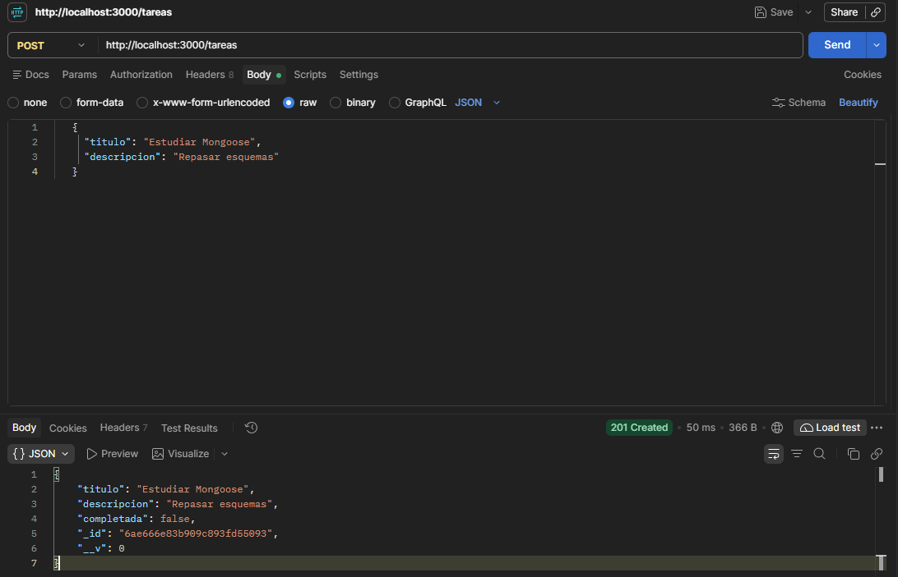

Si falta el título, la validación del esquema responde `400 Bad Request`:

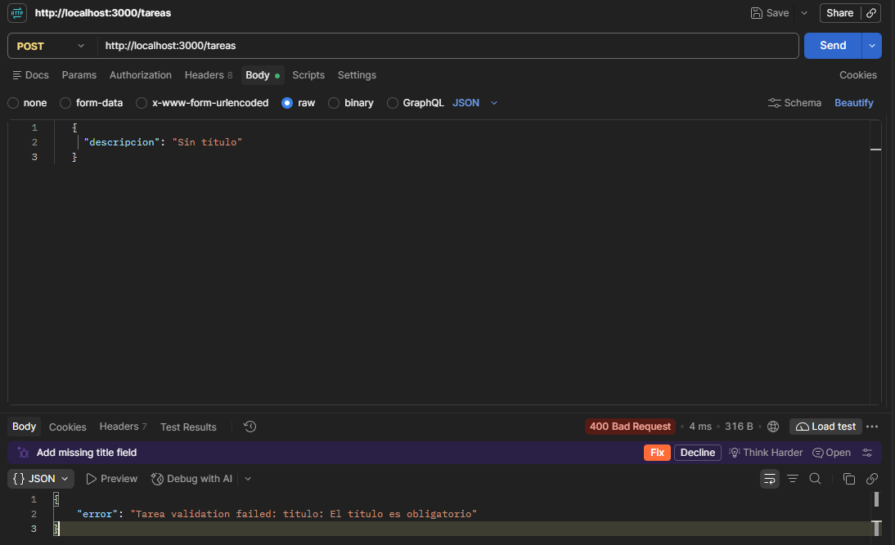

### GET /tareas — obtener todas las tareas

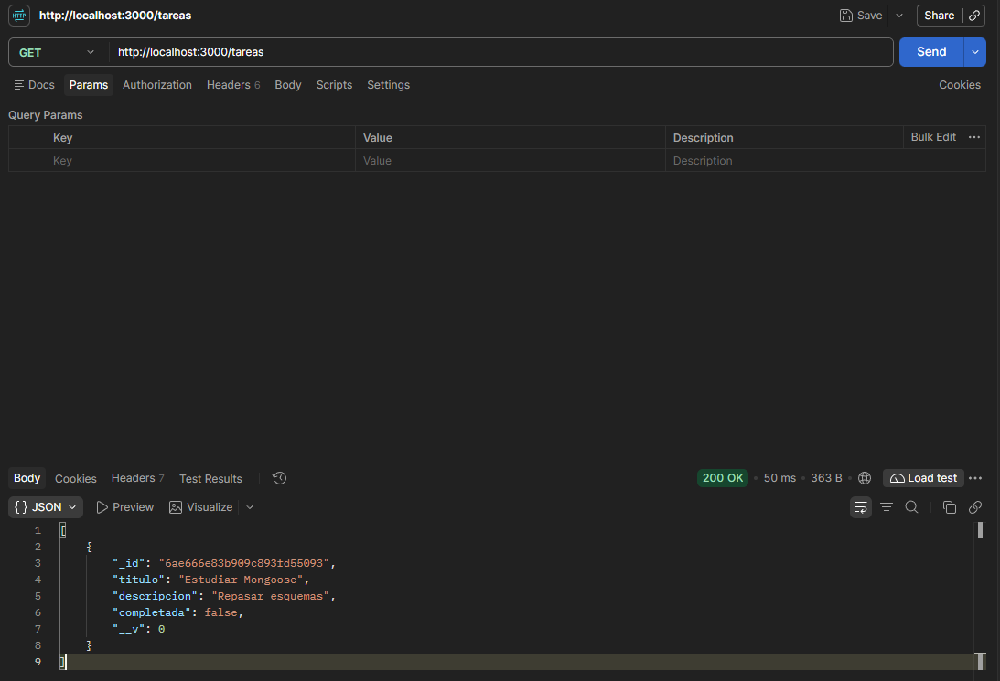

### GET /tareas/:id — obtener una tarea por ID

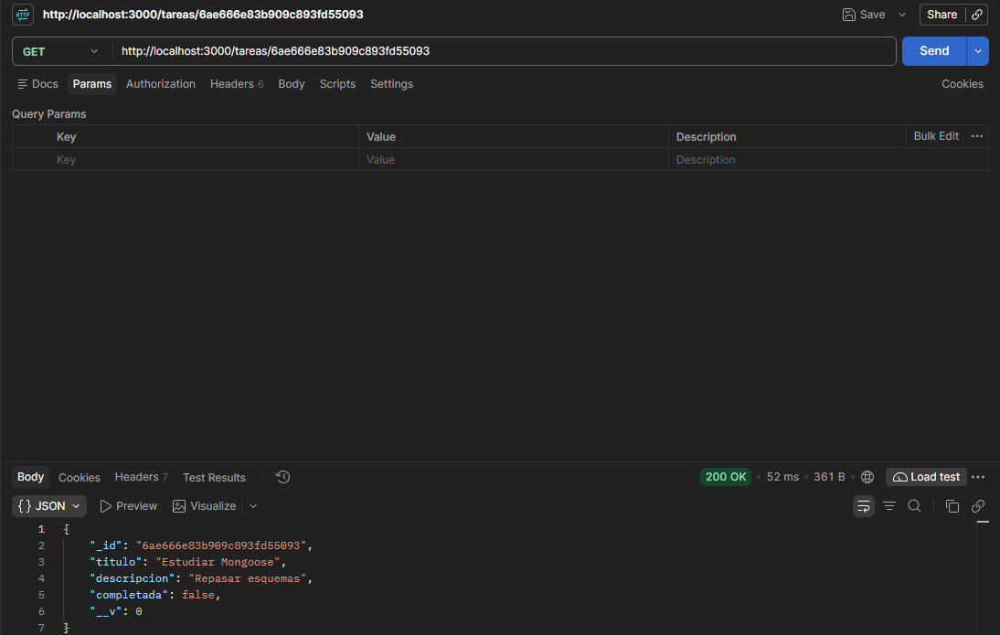

Con un ID válido que no existe responde `404 Not Found`:

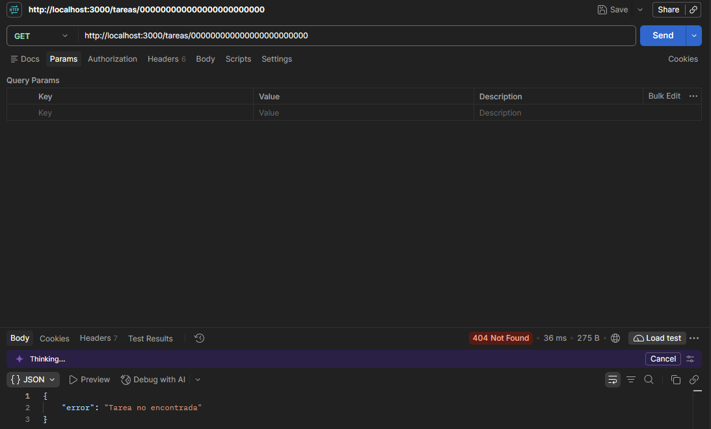

Con un ID de formato inválido responde `400 Bad Request`:

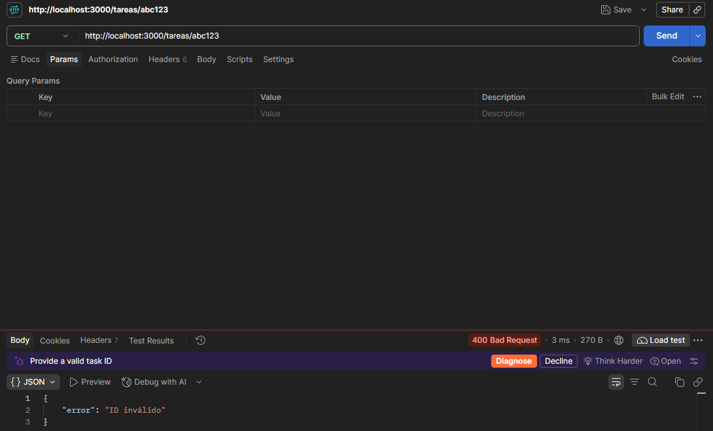

### PUT /tareas/:id — actualizar una tarea

Cuerpo enviado:

```json
{ "titulo": "Estudiar Mongoose y Express", "completada": true }
```

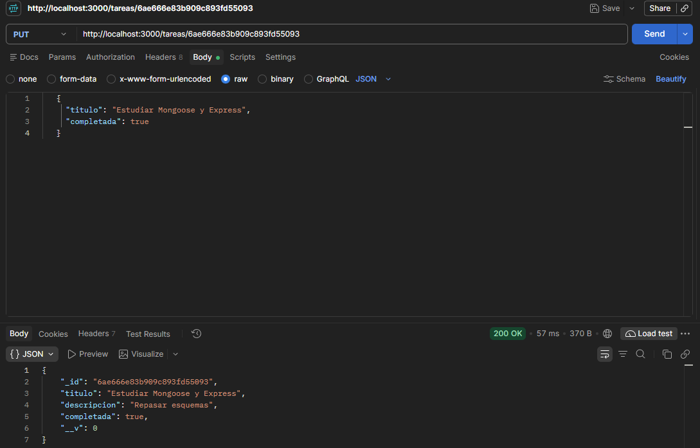

Las validaciones del esquema también se aplican al actualizar:

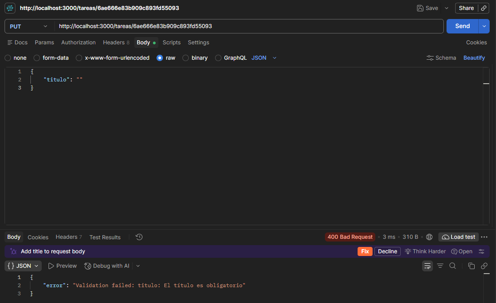

### DELETE /tareas/:id — eliminar una tarea

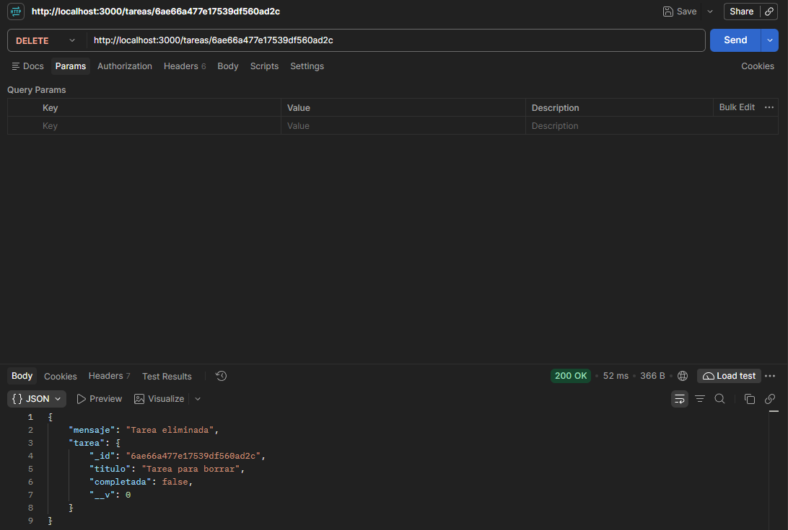

Si la tarea ya no existe responde `404 Not Found`:

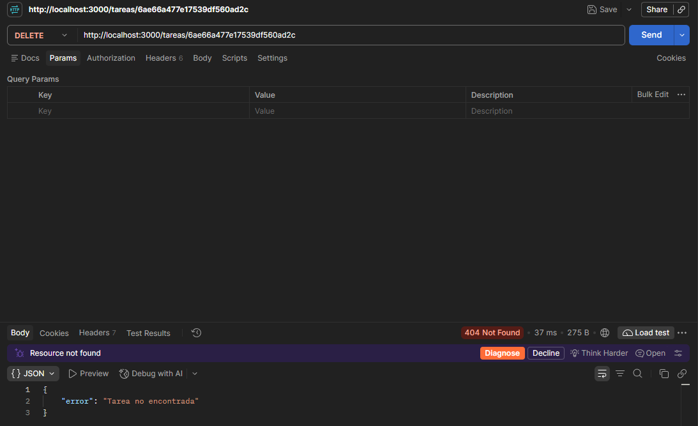

### Verificación en MongoDB Atlas

Los cambios se reflejan en la colección `tareas` de la base de datos:

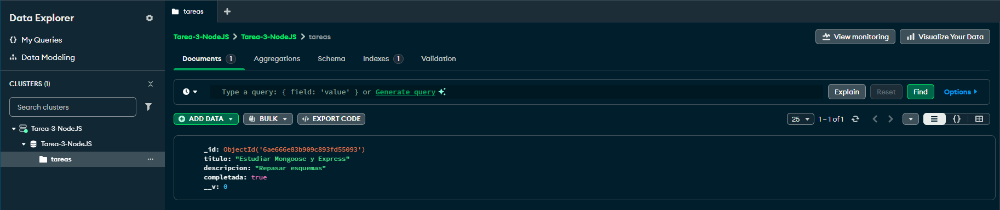

## Créditos

- **Autor:** Nicolas Tissoni
- **Curso:** Desarrollo en NodeJS (Diplomatura Full-Stack)
- **Unidad:** Módulo 1 - Unidad 3: Integrando Mongoose en mi API

## Fuentes

### Libros

- Cantelon, M.; Harter, B.; Holowaychuk, T. y Rajlich, N. *Node.js in Action* [Node.js en acción]. 2ª ed. Manning; 2017.
- Holesovsky, P. *Mastering Mongoose*. Leanpub; 2020.

### Documentación en línea

- Express. (s.f.). *Routing* [Enrutamiento]. https://expressjs.com/en/guide/routing.html
- Mongoose. (s.f.). *Getting Started* [Empezando]. https://mongoosejs.com/docs/index.html
- MongoDB. (s.f.). *MongoDB CRUD Operations* [Operaciones CRUD de MongoDB]. https://www.mongodb.com/docs/manual/crud/
