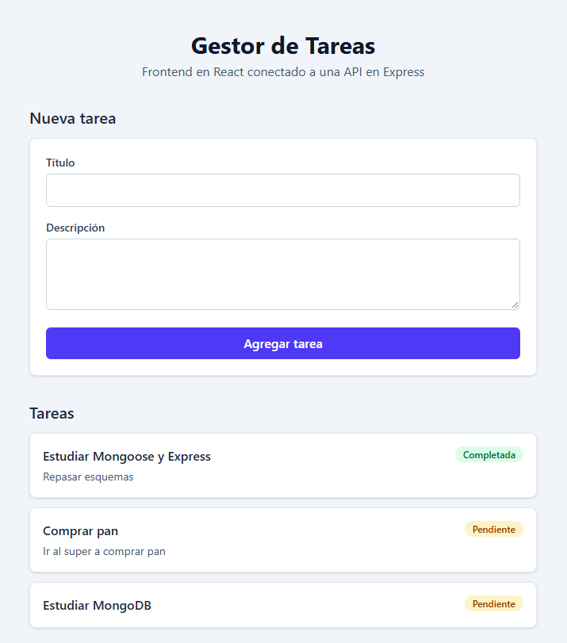
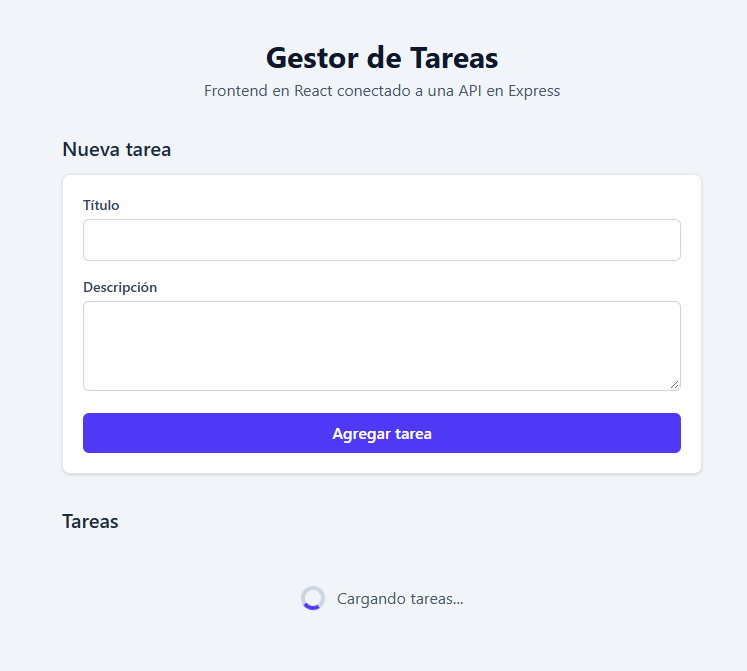
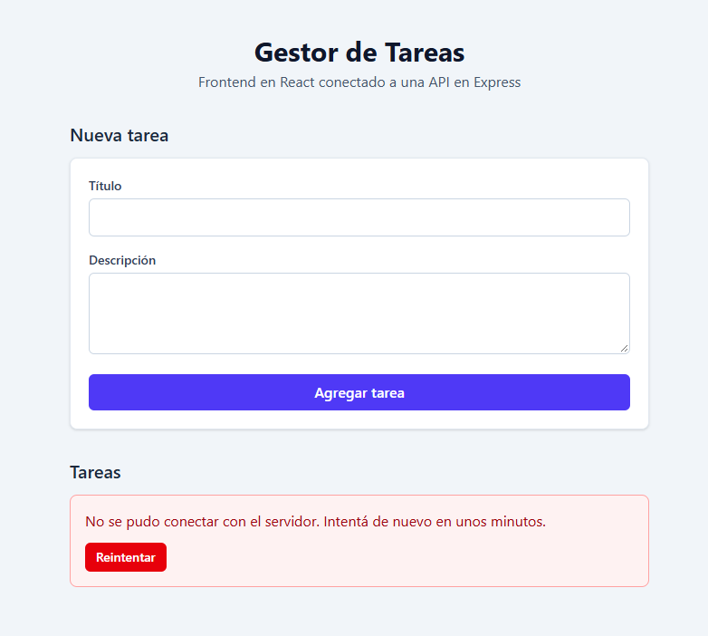
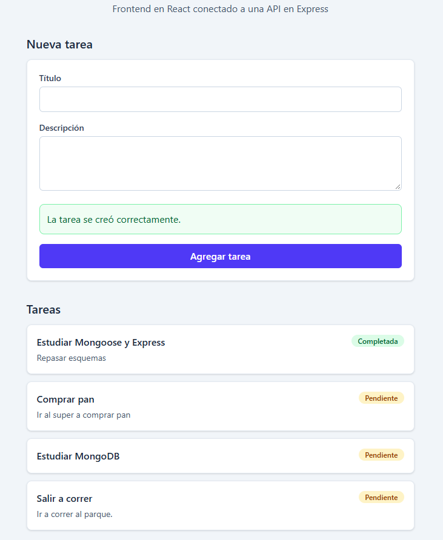
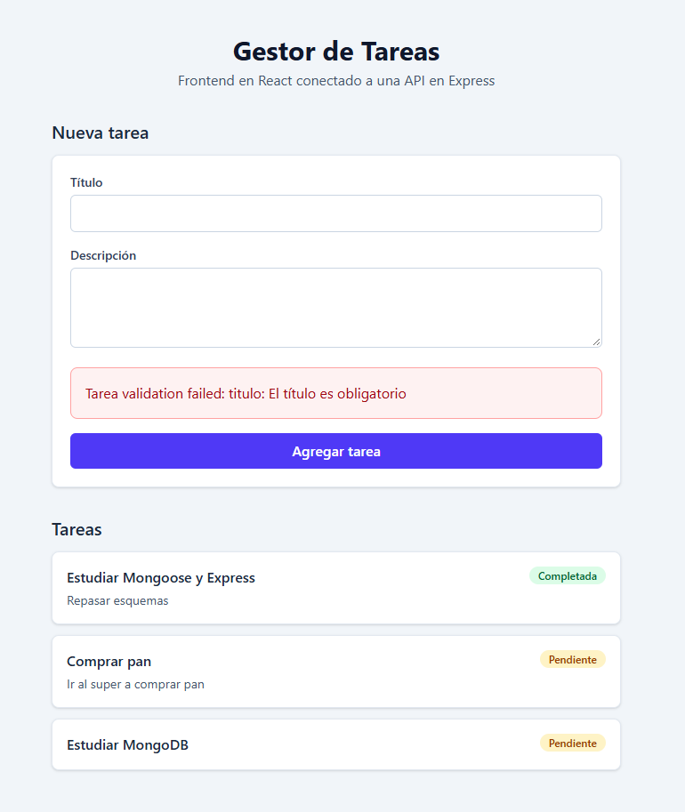
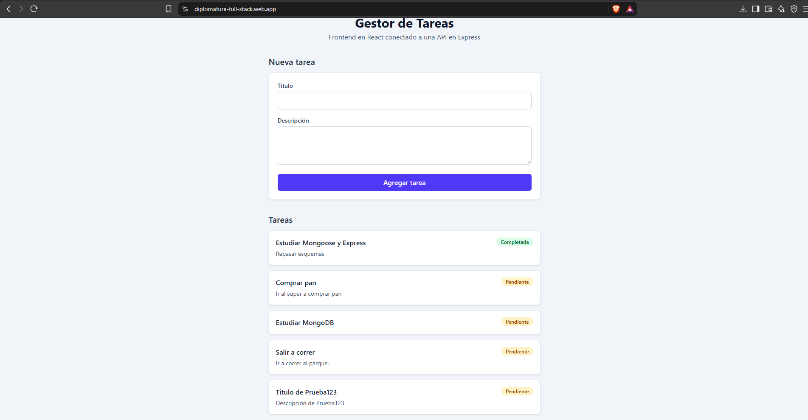
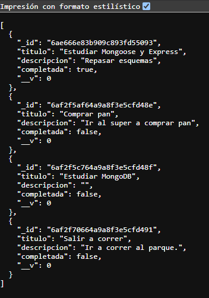

# Gestor de Tareas: integración Front-Back y despliegue

Aplicación web que conecta un frontend en React con una API REST en Express y MongoDB Atlas. El frontend lista las tareas guardadas en la base de datos (GET) y permite crear nuevas desde un formulario (POST). Muestra un indicador de carga mientras llegan los datos y mensajes de error cuando la API no responde o rechaza los datos enviados. El frontend está desplegado en Firebase Hosting y el backend en Render.

## Tecnologías

- **Frontend:** React, Vite, TailwindCSS y `fetch`.
- **Backend:** Node.js, Express, Mongoose y `cors`.
- **Base de datos:** MongoDB Atlas.
- **Despliegue:** Firebase Hosting (frontend) y Render (backend).

## Estructura del proyecto

```
Tarea 4 - Integración con Front/
├── back-end/    API en Express con las rutas de /tareas
├── front-end/   Aplicación React con Vite y TailwindCSS
└── capturas/    Capturas de pantalla de la entrega
```

## Instalación y ejecución

### 1. Clonar el repositorio

```bash
git clone https://github.com/NicAT-12/Diplomatura_Full-Stack.git
cd "Diplomatura_Full-Stack/Desarrollo en NodeJS/Tarea 4 - Integración con Front"
```

### 2. Backend

```bash
cd back-end
npm install
```

Crear un archivo `.env` en `back-end/` tomando como modelo `.env.example`:

```
MONGODB_URI=mongodb+srv://<usuario>:<contraseña>@<cluster>.mongodb.net/<nombre-de-la-base>
PORT=3000
CORS_ORIGINS=http://localhost:5173
```

Ejecutar el servidor:

```bash
npm run dev
```

La API queda disponible en `http://localhost:3000`.

### 3. Frontend

En otra terminal:

```bash
cd front-end
npm install
npm run dev
```

La aplicación queda disponible en `http://localhost:5173`. En desarrollo usa la URL de `.env.development`, que apunta a `http://localhost:3000`.

## Variables de entorno

### Backend (`back-end/.env`)

| Variable | Descripción |
|---|---|
| `MONGODB_URI` | Cadena de conexión a MongoDB Atlas |
| `PORT` | Puerto del servidor |
| `CORS_ORIGINS` | Orígenes del frontend autorizados a consumir la API, separados por coma |

El archivo `.env` está ignorado en Git. `.env.example` sirve como modelo.

### Frontend (`front-end/`)

| Archivo | Variable | Uso |
|---|---|---|
| `.env.development` | `VITE_API_URL` | URL de la API al ejecutar `npm run dev` |
| `.env.production` | `VITE_API_URL` | URL de la API en Render al ejecutar `npm run build` |

Vite elige el archivo según el modo, así que desarrollo y producción quedan separados sin tocar el código.

## Rutas de la API utilizadas por el frontend

| Método | Ruta | Uso en el frontend |
|---|---|---|
| GET | `/tareas` | Mostrar la lista de tareas |
| POST | `/tareas` | Crear una tarea desde el formulario |

## CORS

El backend usa el middleware `cors` y solo acepta peticiones de los orígenes indicados en `CORS_ORIGINS`. En producción esa variable se configura en Render con las URL del frontend publicado en Firebase Hosting.

## Despliegue

### Backend en Render

1. Crear un nuevo **Web Service** en Render y conectar el repositorio de GitHub.
2. Indicar `back-end` como **Root Directory**.
3. Configurar **Build Command** `npm install` y **Start Command** `npm start`.
4. Cargar las variables de entorno `MONGODB_URI` y `CORS_ORIGINS` (con las URL del frontend en Firebase).
5. En MongoDB Atlas, en *Network Access*, permitir el acceso desde la IP de Render.

### Frontend en Firebase Hosting

1. Completar `front-end/.env.production` con la URL del backend en Render.
2. Compilar y desplegar:

```bash
cd front-end
npm install
npm run build
npm install -g firebase-tools
firebase login
firebase use --add
firebase deploy --only hosting
```

`firebase.json` ya está configurado para publicar la carpeta `dist`.

## Enlaces de producción

- **Frontend (Firebase Hosting):** _pendiente de completar_
- **Backend (Render):** _pendiente de completar_

## Capturas de pantalla

### GET: datos obtenidos desde la API



### Estado de carga



### Manejo de errores cuando la API no responde



### POST: formulario enviando datos correctamente



### POST: error de validación devuelto por la API



### Aplicación funcionando en producción





## Créditos

- **Autor:** Nicolas Tissoni
- **Curso:** Desarrollo en NodeJS (Diplomatura Full-Stack)
- **Unidad:** Unidad 4: Integración Front-Back

## Fuentes

### Documentación en línea

- Express. (s.f.). *cors*. https://expressjs.com/en/resources/middleware/cors.html
- React. (s.f.). *useEffect*. https://react.dev/reference/react/useEffect#fetching-data
- Vite. (s.f.). *Env Variables and Modes* [Variables de entorno y modos]. https://vite.dev/guide/env-and-mode
- Tailwind CSS. (s.f.). *Installing Tailwind CSS with Vite* [Instalación de Tailwind CSS con Vite]. https://tailwindcss.com/docs/installation/using-vite
- MDN Web Docs. (s.f.). *Using the Fetch API* [Uso de la API Fetch]. https://developer.mozilla.org/es/docs/Web/API/Fetch_API/Using_Fetch
- Render. (s.f.). *Deploy a Node Express App on Render* [Desplegar una app Node Express en Render]. https://render.com/docs/deploy-node-express-app
- Firebase. (s.f.). *Firebase Hosting* [Alojamiento de Firebase]. https://firebase.google.com/docs/hosting
